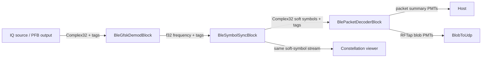

# Bluetooth Low Energy Sniffer

This crate implements a continuous BLE 1M receiver for FutureSDR. It filters IQ,
recovers instantaneous frequency and symbol timing, searches for access
addresses, dewhitens PDUs, validates CRCs, and reports advertising and tracked
connection packets.

It is based on the Bluetooth sniffer contributed by
[@mucaglar](https://github.com/mucaglar) in
[FutureSDR pull request #244](https://github.com/FutureSDR/FutureSDR/pull/244),
and uses FutureSDR and `futuredsp` 0.10.

The crate has one executable, `sniffer`. All reception is continuous: every IQ
sample passes through stream buffers. There is no energy-triggered capture,
squelch, mode selector, or IQ/sample transport through PMTs.

## Quick start

The repository selects nightly Rust through `rust-toolchain.toml`.
Simulation does not require SDR hardware or a hardware backend:

```sh
cargo run --release --no-default-features -- --simulate --simulate-packets 10
```

For live reception through SoapySDR (the default feature):

```sh
cargo run --release -- --args driver=soapy --channels 37 --gain 30
```

Channel 37 is at 2.402 GHz; the default sample rate is 2 MS/s. Stop live reception
with Ctrl+C, or add `--duration 30`. `--quiet` suppresses individual packets while
retaining the final statistics. See all options with:

```sh
cargo run --no-default-features -- --help
```

Other hardware backends can be selected at build time:

```sh
cargo run --release --no-default-features --features rtlsdr -- --args driver=rtlsdr
cargo run --release --no-default-features --features uhd -- --args driver=uhd
```

## Streaming architecture

Each selected channel uses three independently scheduled FutureSDR blocks:



| Block | Work |
| --- | --- |
| `BleGfskDemodBlock` | Causal receive FIR, quadrature demodulation, confidence-based acquisition and tracking of the two frequency levels, CFO/deviation normalization |
| `BleSymbolSyncBlock` | Stateful Mueller and Müller timing recovery with interpolation and bounded symbol-period tracking |
| `BlePacketDecoderBlock` | Soft-symbol sign decisions, incremental access-address/PDU synchronization, dewhitening, CRC validation, connection tracking, packet output |

Filter history, frequency estimates, interpolation state, and partial packets
survive work calls. Output buffers provide normal stream backpressure. EOF
flushes the causal FIR tail before downstream blocks drain. Only complete,
CRC-valid packets are emitted through PMTs.

The minimum input rate is 2 samples per BLE symbol (2 MS/s). Timing recovery
accepts fractional samples-per-symbol rates; the channel low-pass filter is
designed for the actual input sample rate. The deterministic IQ
simulator requires an integer samples-per-symbol rate.

## Library integration and constellation

After creating an IQ source in a `Flowgraph`, connect the stream stages:

```rust,ignore
use futuresdr::blocks::VectorSink;
use futuresdr::prelude::*;
use futuresdr_ble::*;

let demod: BleGfskDemodBlock = BleGfskDemodBlock::new(
    BlePhy::Le1M, 2e6, 37, gfsk_rx_taps(2e6)?,
)?;
let symbols: BleSymbolSyncBlock = BleSymbolSyncBlock::new(2.0)?;
let decoder: BlePacketDecoderBlock = BlePacketDecoderBlock::new(
    BlePhy::Le1M, 2e6, 37, BlePacketDecoderOptions::default(),
)?;
let demod = fg.add(demod)?;
let symbols = fg.add(symbols)?;
let decoder = fg.add(decoder)?;
let plot = fg.add(VectorSink::<Complex32>::new(1024))?;
connect!(fg, source > demod > symbols > decoder);
connect!(fg, symbols > plot);
```

`BleSymbolSyncBlock.output` is the actual constellation input to the decoder's
bit decisions. Samples are `Complex32(normalized_frequency, 0)`, normally near
−1 or +1 on the real axis. Values preserve noise and amplitude variation;
they are not clipped, converted to phase angles, or filtered by CRC success.
One timing-recovered symbol stream feeds both the decoder and the viewer.
There is no constellation PMT output or enable flag. The CLI prints packet
summaries; a graphical viewer can be attached through the library API.

The decoder's `packets` message output emits `Pmt::String` summaries. With
`BlePacketDecoderOptions.wireshark_output`, its `wireshark` output emits
`Pmt::Blob` RFTap packets. They send `Finished` at EOF (`wireshark` when enabled).

For multiple channels, give packet decoders the same `SharedConnectionTable`
using `with_connections`.

## Stream tags and retuning

The `ble` tag is `Tag::NamedAny` containing a public `BleStreamMetadata`:

| Field | Meaning |
| --- | --- |
| `phy`, `channel_index` | BLE PHY and whitening channel at the tagged item |
| `sample_rate_hz` | Original per-channel IQ sample rate |
| `sample_index` | Original IQ sample clock at the tagged item |
| `sample_delay` | FIR/discriminator delay in IQ samples |
| `discontinuity` | Reset DSP and partial-packet state before the tagged item |

The demodulator inserts initial metadata. It also accepts source metadata tags
created with `BleStreamMetadata::to_tag`; callers can inspect them with
`BleStreamMetadata::from_tag`. The default source clock starts at zero and
counts consumed IQ samples. A source can supply its own sample-clock anchor.

The symbol synchronizer maps metadata and other source tags to the first output
symbol at or after the tagged input. On the symbol stream, each `Tag::Id(u64)`
identifies that symbol's rounded original IQ sample index, compensating FIR
and discriminator delay. `Tag::Id` is reserved for this source-clock meaning
on BLE symbol streams. The packet decoder uses these timestamps for connection
tracking instead of treating compacted symbol indices as IQ sample indices.

The demodulator's `frequency` message input accepts an F64 RF center frequency
in Hz. A retune resets its filter/frequency state and inserts metadata with the
new channel and a discontinuity at the next consumed sample, preserving the
running source clock. The downstream synchronizer and decoder reset at that
same tagged boundary. Null queries the frequency; invalid frequencies return
`InvalidValue`. Send the same frequency to the SDR's `freq` input.

Changing sample rate requires rebuilding the receive filter and flowgraph.
Hosts can report sample loss to `SharedConnectionTable::observe_overflow`.

## Multiple channels and connection following

A comma-separated list enables PFB channelization, followed by a continuous
receiver on each selected output:

```sh
cargo run --release -- --channels 37,0 --gain 30
cargo run --release -- --channels 38,10,11 --follow-connections --gain 30
```

The SDR must support the required bandwidth. If the default rate is left at
2 MS/s, the CLI automatically chooses a suitable multi-channel input rate.
Each selected PFB channel is sampled at 2 MS/s. Multiple channels currently
require hardware input.

The follower learns access addresses, CRC initialization, and channel-selection
parameters from `CONNECT_IND`, predicts CSA #1/#2 events, and validates data
PDUs using connection-specific contexts. `--follow-connections` restricts data
access-address searches to predicted windows; filtering, demodulation, and
timing recovery still process every input sample. It requires at least two
selected channels. Link-layer connection/channel-map updates remain supported.

## Offline IQ and Wireshark

Files contain interleaved `f32` IQ samples (`I0 Q0 I1 Q1 ...`). Match the selected
channel and sample rate to the recording:

```sh
cargo run --release --no-default-features -- \
  --iq-file capture.iq --sample-rate 2e6 --channels 37 --quiet
```

Finite sources run to EOF; `--duration` applies only to live hardware.

To stream decoded packets to Wireshark:

```sh
cargo run --release -- --channels 37 --wireshark
```

The default destination is `127.0.0.1:55556`; override it with
`--wireshark-addr`. Capture loopback traffic and configure UDP port 55556 with
**Decode As… → RFTap**. Use the `btle` display filter.

## Validation and design references

```sh
cargo test --no-default-features
cargo test --no-default-features --test stream_pipeline
```

Tests exercise fragmented input, output backpressure, source-clock and channel
tags, EOF, packet outputs, and constellation fanout. Gaussian BT=0.5 packet
tests vary SNR, transmitter frequency, fractional arrival time, clock error,
payload, and absolute signal power, with noise-only gaps between packets.
The frequency estimator acquires quickly from a credible constant-envelope
signal, then tracks slowly; noise and short runs of identical bits must not
repeatedly move the decision threshold. This confidence check only controls
estimator updates: samples always pass through the stream.
Protocol tests cover CRC,
whitening, connection following, and link-layer control handling.

The continuous architecture follows the separation of quadrature demodulation,
clock recovery, and slicing used by
[GNU Radio's GFSK demodulator](https://github.com/gnuradio/gnuradio/blob/main/gr-digital/python/digital/gfsk.py)
and described in [Symbol Sync](https://wiki.gnuradio.org/index.php/Symbol_Sync).
This remains a BLE 1M receiver; LE 2M/Coded PHYs are not implemented. Synthetic
regression tests do not establish RF sensitivity or wideband real-time throughput.

## License

[Apache License, Version 2.0](LICENSE).
